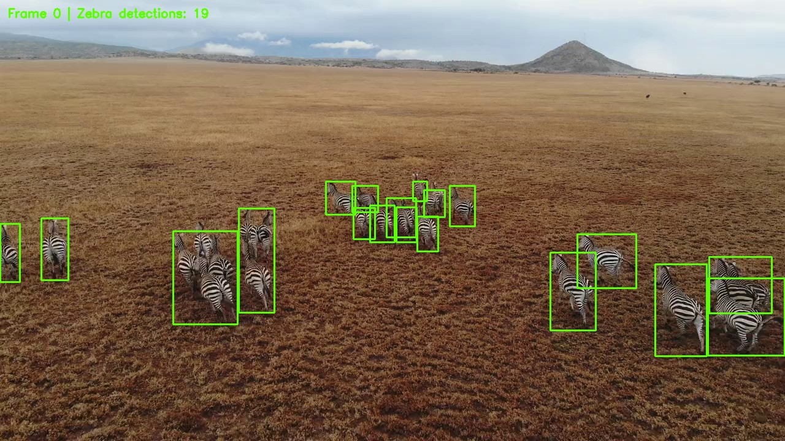

# Gán nhãn video bằng AWS Rekognition

**Tiếng Việt** | [English](README_EN.md)

[](https://github.com/DuongDuyet2909/aws-rekognition-video-annotation/actions/workflows/tests.yml)

[](LICENSE)

Dự án đọc video ngựa vằn, sử dụng Amazon Rekognition Image để phát hiện đối tượng trên các khung hình được chọn và xuất nhãn theo định dạng YOLO. Các công cụ offline hỗ trợ sửa nhãn cũ, vẽ kết quả và chuẩn bị tập mẫu cho người kiểm duyệt. Kết quả đầu ra không phải số lượng cá thể động vật khác nhau và chưa chứng minh độ chính xác của mô hình.



Phát triển từ [tutorial AWS Rekognition của Computer Vision Engineer](https://github.com/computervisioneng/object-detection-aws-rekognition-tutorial), bổ sung sửa nhãn, tiếp tục xử lý sau gián đoạn, giới hạn số lượt gọi API, xuất hình/video và công cụ đánh giá. Trọng tâm của dự án là kỹ thuật xử lý và gán nhãn; dự án không huấn luyện mô hình mới hay khẳng định độ chính xác phát hiện.

## Mã nguồn và dữ liệu đầy đủ

Repository chứa toàn bộ mã ứng dụng, tài liệu, kiểm thử, CI và các báo cáo đã ghi nhận. [Release v1.0.0](https://github.com/DuongDuyet2909/aws-rekognition-video-annotation/releases/tag/v1.0.0) chứa gói demo đầy đủ: video gốc và toàn bộ tệp đầu ra hiện có, gồm 755 ảnh khung hình gốc, 755 ảnh đã vẽ kết quả, nhãn, metadata, mẫu kiểm duyệt, video kết quả và bản sao lưu nhãn ban đầu. Thông tin đăng nhập, môi trường Python và bộ nhớ đệm Python không được đưa vào.

Gói dữ liệu lớn hơn 500 MiB nên được lưu trong Release thay vì đưa hàng nghìn tệp lớn vào lịch sử Git. [Tải toàn bộ demo](https://github.com/DuongDuyet2909/aws-rekognition-video-annotation/releases/download/v1.0.0/aws-rekognition-complete-demo.zip), hoặc khôi phục bằng công cụ kiểm tra checksum bên dưới. Không cần tài khoản AWS để sử dụng kết quả đã lưu.

Kết quả đã kiểm tra trên máy: **755 khung hình, 12.720 bounding box và không còn dòng nhãn trùng sau khi sửa**; đã loại bỏ **12.720 dòng nhãn bị lặp**. Đây là số liệu kiểm tra tính toàn vẹn đầu ra, không phải độ chính xác hay số cá thể động vật. Hiện có **26 mẫu đang chờ người kiểm duyệt**; chưa có precision/recall trên dữ liệu thực cho đến khi hoàn thành bước này. Xem [báo cáo tổng quan](TONG_QUAN.md) và [kết quả kiểm tra đã lưu](reports/verification_after.json).

## Cài đặt

Sử dụng Python 3.11 trong môi trường ảo mới. Dự án dùng NumPy 2 cho OpenCV 5; nên tách riêng với các dự án TensorFlow cần NumPy 1.

```bash
git clone https://github.com/DuongDuyet2909/aws-rekognition-video-annotation.git
cd aws-rekognition-video-annotation
python -m venv .venv
```

Kích hoạt `.venv` bằng `.\.venv\Scripts\Activate.ps1` trong PowerShell, hoặc `source .venv/bin/activate` trên Linux/macOS, sau đó chạy:

```bash
python -m pip install -r requirements.txt
python -X utf8 scripts/restore_demo.py --download
```

Công cụ khôi phục kiểm tra SHA-256 của gói dữ liệu, từ chối đường dẫn không an toàn, bảo vệ dữ liệu đầu ra đã tồn tại và tạo lại danh sách ảnh YOLO phù hợp với máy hiện tại. Cần chạy trên bản clone mới, chưa có `output/` hoặc `zebras.mp4`. Nếu đã tải gói dữ liệu, dùng `python scripts/restore_demo.py --archive /path/to/aws-rekognition-complete-demo.zip`. Thông tin gói nằm trong [reports/demo_asset.json](reports/demo_asset.json).

Trên máy Windows của chủ dự án, `run_offline.cmd` cũng có thể dùng môi trường đã chuẩn bị tại `%USERPROFILE%\.aws-rekognition-venv`. Người dùng khác nên tạo `.venv` theo hướng dẫn trên.

## Sử dụng kết quả có sẵn, không gọi AWS

```powershell
python -X utf8 main.py detect --offline --stride 1 --max-api-calls 0
python -X utf8 main.py render
python -X utf8 main.py audit
```

Hoặc chạy `run_offline.cmd` trong terminal. Gói demo đã có khung hình, nhãn được sửa và metadata cache được nhập từ dữ liệu cũ; hãy khôi phục gói trước khi chạy trên bản clone mới. `detect --offline` kiểm tra các tệp cache và không tạo AWS client. `render` xuất `output/annotated_images/`, `output/preview.jpg` và `output/annotated_video.mp4`, giữ nguyên tốc độ khung hình và thời lượng video. Khung hình chưa có dự đoán được ghi rõ `Not analysed` (chưa phân tích), tránh nhầm với kết quả không phát hiện đối tượng.

Để sửa một bộ nhãn cũ khác, trước tiên đặt video tương ứng tại `zebras.mp4`, kèm các cặp `output/images/frame_XXXX.jpg` và `output/annotations/frame_XXXX.txt`, rồi chạy:

```powershell
python -X utf8 main.py repair
```

Lệnh này kiểm tra nhãn, sao lưu bản gốc vào `output/backups/annotations_before_repair_*.zip`, loại bỏ các dòng trùng hoàn toàn, tạo tệp tương thích trong `output/labels/` và ghi metadata. Kết quả nhập từ dữ liệu cũ có `confidence: null`, không có phản hồi API gốc và mang `origin: legacy_import`. Cấu hình yêu cầu được suy ra từ mã cũ: lớp Zebra, ngưỡng nhãn 50, không lọc riêng theo confidence của từng đối tượng, chất lượng JPEG 95 và kích thước lớn nhất 1280 pixel. Metadata này không phải nhật ký kiểm toán do AWS cung cấp.

## Xử lý mới bằng AWS

Ứng dụng dùng cơ chế tìm thông tin xác thực tiêu chuẩn của Boto3: biến môi trường, AWS profile hoặc IAM role. Mã ứng dụng không chứa khóa truy cập trực tiếp. Có thể cấu hình profile riêng bằng AWS CLI: `aws configure --profile aws-rekognition-tutorial`, hoặc dùng thiết lập IAM/biến môi trường sẵn có. Git và gói Release không chứa thông tin đăng nhập.

```powershell
python -X utf8 main.py detect --profile aws-rekognition-tutorial --stride 30 --max-api-calls 25
```

- Mặc định lấy một khung hình sau mỗi 30 khung hình nguồn. Với video 755 khung hình, cách này chọn **26 khung hình**, so với 755 trước đây: giảm 96,56% số yêu cầu ảnh dự kiến khi chưa có cache. Đây không phải mức giảm hóa đơn đã đo thực tế. Với giới hạn 25, lần chạy hoàn toàn chưa có cache sẽ chưa xử lý hết; chạy lại để xử lý khung hình còn thiếu, tận dụng cache của phần đã xong.
- `--max-api-calls` giới hạn số lượt gọi logic mới đến `detect_labels` trong lần chạy đó. Mỗi lượt có thể thực hiện tối đa ba lần thử HTTP của SDK với cơ chế retry/backoff tiêu chuẩn. Đây không phải giới hạn bằng tiền. `--max-api-calls 0` cấm gọi API mới.
- Bỏ qua cache đã hoàn tất và khớp cấu hình. Phản hồi gốc được lưu trước các tệp kết quả cuối cùng để có thể khôi phục lần ghi bị gián đoạn mà không gọi lại API. Kiểm tra cache bao gồm hash video, cấu hình yêu cầu, hash ảnh và hash nhãn. Dùng thư mục đầu ra khác cho video hoặc cấu hình phát hiện khác để tránh trộn dữ liệu từ các chính sách khác nhau.
- `--refresh` yêu cầu tạo lại kết quả, bỏ qua cache; không dùng cùng `--offline`.
- Lỗi xác thực hoặc phân quyền làm dừng lần chạy. Các khung hình lỗi khác được ghi trong `output/run_summary.json`; lần chạy sau chỉ thử lại các mục thiếu hoặc không hợp lệ. Xử lý chưa hoàn tất trả mã thoát 2; lỗi đầu vào/cấu hình trả mã 1.
- Kiểm tra mã hóa JPEG trước khi gửi; ảnh quá lớn bị từ chối kèm hướng dẫn. `--max-dimension` và `--jpeg-quality` điều chỉnh kích thước dữ liệu gửi. Tọa độ box chuẩn hóa vẫn tương ứng với kích thước khung hình gốc.

Ví dụ lọc chặt hơn theo confidence của từng đối tượng đối với phản hồi mới:

```powershell
python -X utf8 main.py detect --profile aws-rekognition-tutorial --output output_conf70 --instance-confidence 70 --max-api-calls 5
```

Mặc định `--label-confidence 50 --instance-confidence 0` giữ chính sách của mã cũ. Thay ngưỡng cần thư mục đầu ra riêng và phản hồi mới. Không thể lọc lại nhãn TXT cũ theo confidence vì thông tin đó không có. Dự án chỉ hỗ trợ một lớp Zebra, chưa có theo dõi đối tượng hoặc huấn luyện mô hình.

## Xuất dữ liệu YOLO

```powershell
python -X utf8 main.py export-yolo --every 5 --validation-fraction 0.2 --gap 30
```

Lệnh tạo `output/data.yaml`, `output/splits/train.txt` và `output/splits/val.txt`. Ảnh giữ tại `output/images/`, ghép với `output/labels/`; danh sách tham chiếu đến ảnh thay vì sao chép cả bộ dữ liệu. Chia theo thời gian và chừa khoảng cách giữa các nhóm giúp giảm sự chồng lấn của khung hình liền kề. Tuy nhiên, đây là nhãn giả từ một video; hai tập vẫn chung bối cảnh và động vật nên tập validation chưa độc lập. Cần kiểm duyệt nhãn trước khi huấn luyện. Nếu di chuyển dự án, hãy tạo lại danh sách vì đường dẫn ảnh được sinh là đường dẫn tuyệt đối.

## Kiểm duyệt thủ công và đánh giá

```powershell
python -X utf8 main.py prepare-review --every 30
```

`output/review/` chứa 26 ảnh, nhãn đề xuất và `review.csv`. Mở bằng công cụ gán nhãn tương thích YOLO, sửa box thiếu, box sai hoặc sai vị trí, rồi đặt `status` thành `reviewed` và điền `reviewer` cho từng khung hình đã hoàn tất. Không đánh dấu đã kiểm duyệt nếu chưa xem và sửa nhãn. Công cụ từ chối ghi đè tập kiểm duyệt đã tồn tại.

```powershell
python -X utf8 main.py evaluate --ground-truth output/review --iou 0.5
```

Đánh giá yêu cầu tập nhãn tham chiếu riêng đã được kiểm duyệt đầy đủ. Kết quả gồm TP/FP/FN, precision, recall, F1 và IoU trung bình của các cặp box ghép đúng trên tập mẫu đó. Khi có confidence thực cho từng đối tượng, công cụ tính thêm AP50 cho một lớp và AP trung bình qua các ngưỡng IoU 0,50–0,95, dùng nội suy 101 điểm. Đây là bộ đánh giá nhỏ, chưa triển khai đầy đủ giao thức COCO (không có các nhóm crowd/diện tích). AP/mAP để `null` với box cũ không có confidence; không tự tạo điểm số. Chưa công bố độ chính xác thực tế khi bước kiểm duyệt chưa hoàn tất.

## Đầu ra và kiểm thử

```text
output/images/             Ảnh khung hình gốc
output/annotations/        Nhãn YOLO đã bỏ dòng trùng, giữ vị trí tương thích mã cũ
output/labels/             Nhãn theo quy ước thư mục YOLO
output/metadata/           Confidence, nguồn gốc, cấu hình và hash
output/responses/          Phản hồi AWS mới và ngữ cảnh yêu cầu; dữ liệu cũ không có
output/annotated_images/   Khung hình đã vẽ box
output/annotated_video.mp4 Video kết quả giữ FPS nguồn
output/review/             Tập kiểm duyệt và bảng trạng thái
output/*_report.json       Báo cáo kiểm tra, sửa nhãn, render, dữ liệu và đánh giá
```

```powershell
python -X utf8 -m unittest discover -s tests -v
python -m pip check
```

Có 16 kiểm thử: 12 kiểm thử pipeline/đánh giá và bốn kiểm thử tính toàn vẹn, an toàn của gói Release. Kiểm thử dùng video ngắn tự tạo và AWS client giả lập rõ ràng, bao phủ sửa nhãn, lọc, xử lý confidence, vô hiệu hóa cache, giới hạn lượt gọi, khôi phục phản hồi, lỗi xác thực, thời lượng video, chia tập theo thời gian và điều kiện kiểm duyệt. Chúng không gọi AWS và không đo chất lượng phát hiện ngựa vằn.

Dữ liệu lớn và video kết quả được cung cấp qua GitHub Releases; quy tắc ignore ngăn đưa chúng vào lịch sử Git. Phân tích đầy đủ và số liệu trước/sau nằm trong [TONG_QUAN.md](TONG_QUAN.md).

## Nguồn tham khảo và giấy phép

Tutorial gốc của computervisiondeveloper / Computer Vision Engineer (MIT, 2022). Các phần chỉnh sửa giữ thông báo bản quyền gốc trong [LICENSE](LICENSE). Nguồn video/dữ liệu được ghi tại [THIRD_PARTY_NOTICES.md](THIRD_PARTY_NOTICES.md); giấy phép mã nguồn không cấp thêm quyền sử dụng video của bên thứ ba.

Tài liệu tham khảo: [thông tin xác thực Boto3](https://docs.aws.amazon.com/boto3/latest/guide/credentials.html), [cơ chế thử lại Boto3](https://docs.aws.amazon.com/boto3/latest/guide/retries.html), [DetectLabels](https://docs.aws.amazon.com/rekognition/latest/APIReference/API_DetectLabels.html).
